Normally I'd never say something like "she/he's literally me" because that's attributing my own characteristics onto someone else---and that's projection, whereas reflection is an objective practice of observing one's own thoughts and behaviors from someone/something else, to understand oneself better. But there are still many times where I'd be either laughing ridiculously or deeply sentimental because "holy shit I completely know what she's thinking and what will she do because SHE'S EXPERIENCING EXACTLY WHAT I DID and REACTING THE SAME WAY AS I DID!" Those moments make me feel comforted, I guess? For example, there's this scene in Hibike Euphonium where a girl named Yuuko was crying and fighting tooth and nail for her senpai's right to perform one last time. Yuuko's antagonist was Kousaka Reina, who had taken away that right because Reina did better in audition. The scene was built up for like 3-4 episodes or something, and to be honest, her reasons were reasonable and the scene was moving and touching and persuading and shit. With no regards to anyone's emotion, though, Reina simply walked out of the drama, found a private place with her best friend---Kumiko---then spouted everything out without holding back, and the episode shifted 180 degrees in an instant. "God DAMN, what is her problem?"---the "her" being the sobbing Yuuko in the background---"she can hardly even PLAY! What's WRONG with her?!" Kumiko still hadn't been able to process the paradoxically juxtaposed vibe between the previously teary group of people and the now clueless, almost self-centered and apathetic, Reina. Before Kumiko could even think of anything to say, Reina locked her eyes onto Kumiko's and asked as if it'd been so obvious: "Don't you think so?" She couldn't read the room AT ALL LOL!!!! All she knew about was talent and she was completely blinded to anything else. We're in a competition? what matters more than competence??? what's this melodrama lol I'M NOT EVEN AWARE OF IT. And THAT WAS EXACTLY MEEEEEE!!! ACCURATE TO SURGICAL PRECISION!!!!! THAT WAS ALL I WAS MADE OF since what, 8th grade until THE SECOND YEAR OF UNIVERSITY. That scene right there, I feel like I'm the person who UNDERSTANDS Reina the MOST in the WORLD and not even KYOANI can compete.

And then there's this random day. I wanted something to play in the background, so I turned on a review of an anime I had absolutely no interest in. 3 minutes in and, again I thought, "hold up, she is LITERALLY ME" then proceeded to turn off the review immediately, got myself a 20GB copy of the anime, then proceeded to religiously watch this shit.

The shit was Uma SS2.

I knew nothing about Umamusume beforehand. The most exposed I was to the media were brainrot memes and my own [uma repository](https://github.com/iluvgirlswithglasses/linux-desktop-gremlin). Up until now, I've only watched the Tachyon movie in addition---which isn't very related to SS2 at all---so you know it, I'm what you may call a larper. So why is a larper acting all condescendingly here, about to spit out "You don't know shit about Tokai Teio" or "no one can relate to Teio as much as I do?" Well, I do admit those words are exaggerated, but it's just pure serendipity that we were on the same page. Many pages. If you read [the first dont-read-me](./dont-read-me.md)---which I think you did because how else would you be reading this---you may have known I had a hard time picking myself up after a perfectly accomplished stage of my life. If you know ME close enough in real life, you may have also known that my entire career kicked off from a friendly rivalry with Kither, almost died off when I lost sight of him, and only flourished again because he re-appeared (many more times than I deserved) like some Deus Ex Machina. The journey of Tokai Teio is somehow a direct reflection of this aspect of me. Her undisputed talent and effort earned her accomplishments few could think of; but soon, as those accomplishments mattered less over time, Teio had to learn other purposes, and it is those OTHER purposes that made her far greater than she thought she could be, far greater than her original aims. And from start to finish, no good deed would have happened if McQueen wasn't there.

I made a point to mention Hibike Euphonium, because Hibike Euphonium as Ayano Takeda writes it has inherent emotions and details that only those who spent their adolescence fighting tooth-and-nail in competitions can spot and understand. I'm not talking about the accuracy of how a concert band operates or whatever technical realism, I'm talking the _texture_ of competitive obsession: the way Reina snatched her chance when she hears about seating arrangements, the specific flavor of Kumiko's frustration at not being able to improve (famous meme btw), the bizarre tension between wanting your teammate to succeed and needing them to fail so you can advance, the exact cadence of post-competition emptiness that settles in regardless of whether you won or lost, the pinpoint school uniform change in a regional contest... and this would go on forever if I keep listing. I **concretely knew** Ayano Takeda was in serious high school competition without even having to look up her profile, because the abundant number of minute details that carried over to the anime is so specific and niche I could spot it from miles away. Takeda lived it all, and showed it in every single line of dialogue and audiovisual expression. And just like the way Eupho is taken to the next level by Takeda's uncompromising authenticity, Uma SS2 benefits the same from real-life horse racing history and the brilliant staff behind it who understood that adapting Tokai Teio and Mejiro McQueen's story was about capturing the *why* underneath every moment two competitors recognize each other.

|       |       |
| ----- | ----- |
| 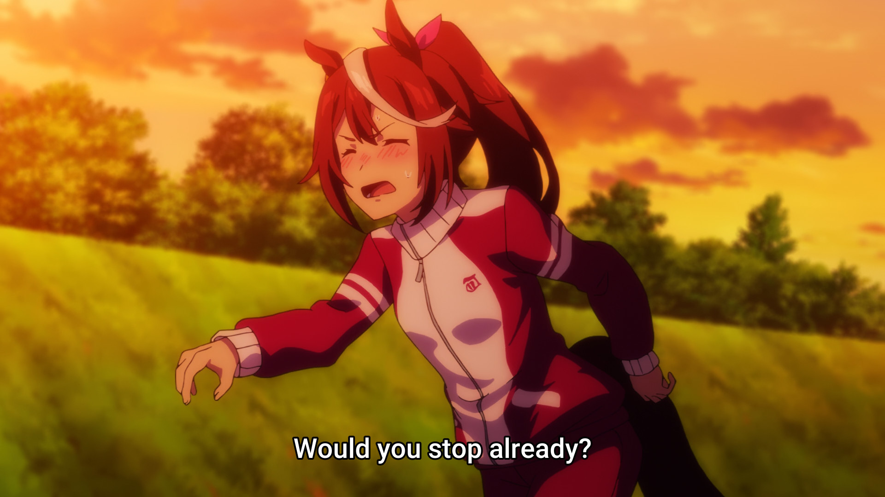 | 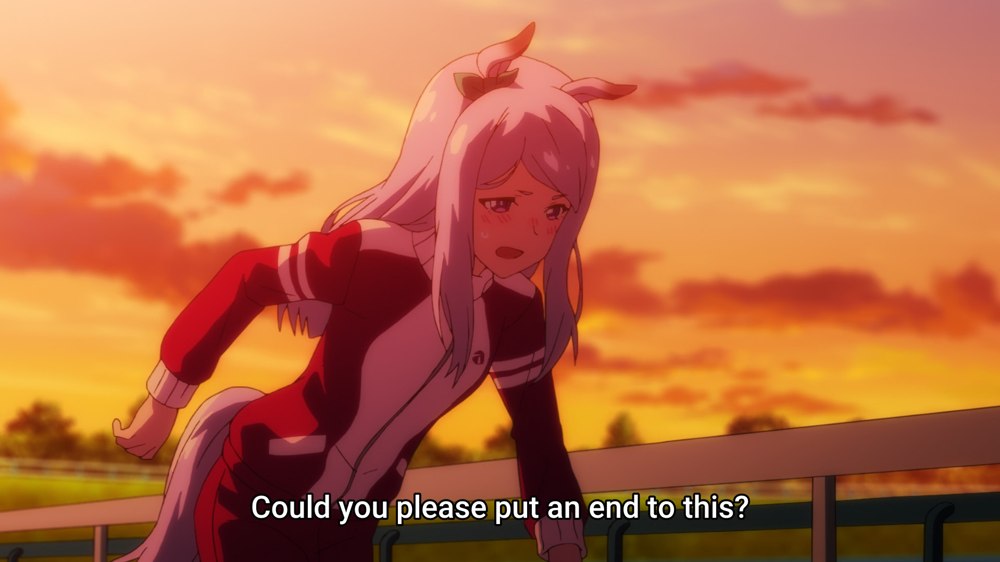 |

This is not a review, so I'm not gonna recap anything, and I hope you remember the mood of Teio and McQueen's first encounter well. They were the two most promising kids of their generation; and right after they crossed eyes, a lifelong bond made of rivalry was established. Their first form of communication was stealing glances btw---which, I admit, are awkward and cute and are golden-quality shipbait materials---and that's also the realest "I gotta lock the fuck in" physical storytelling you could have come up with on the screen, and locked in they did. At first out of some "I must be the best" protagonist syndrome; but later, it was because this rivalry is their proving ground. Teio and McQueen are each other's proving ground; no matter how much they win or lose anywhere else, as long as they still race each other, then their footsteps still have meaning. However, Teio didn't seem to understand that right away. Not yet.

The importance of this rivalry is twofold: one for the contestant's side, and one for the audience's side. For the former, there's a line in the first episode: "To be like Rudolf, you're going to need talent, effort, and luck. And you can't afford to miss a single one." I know I've lost my race long ago, but I can at least assure you that you don't know if you actually have all three until someone tests you. As for the latter: take the rivalry away and victories will become dull. See Agnes Tachyon for example: she's far more effective as an antagonist, as an "aura monster", because the pressure she creates is worth more than whatever inspirational journey they could've constructed if her career was the focus of the movie ~(actually I like it this way because I want her to dominate me, kek)~. Likewise, it's impossible to build a season around Symboli Rudolf because her career is just unbroken dominance from start to finish.

Talk about Rudolf... she has to be the blandest person in the show. She's just *there* like a statue, an ideal. Apart from that line about talent, effort, and luck; she's about as deep as the motivational poster Teio had on her wall. When Teio and Rudolf converse, it feels like Teio's talking to herself: no pushbacks, no lessons a fortune cookie couldn't deliver, no inspiration beyond "wow she's so perfect and cool." But this bland ass undefeated statue was what Teio wanted to be. And what would happen if that's all you strive for, hmphmm?

|       |       |
| ----- | ----- |
| 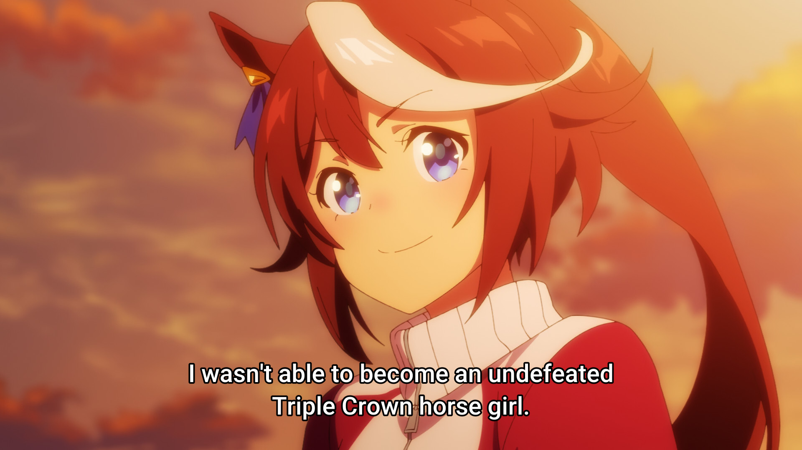 | 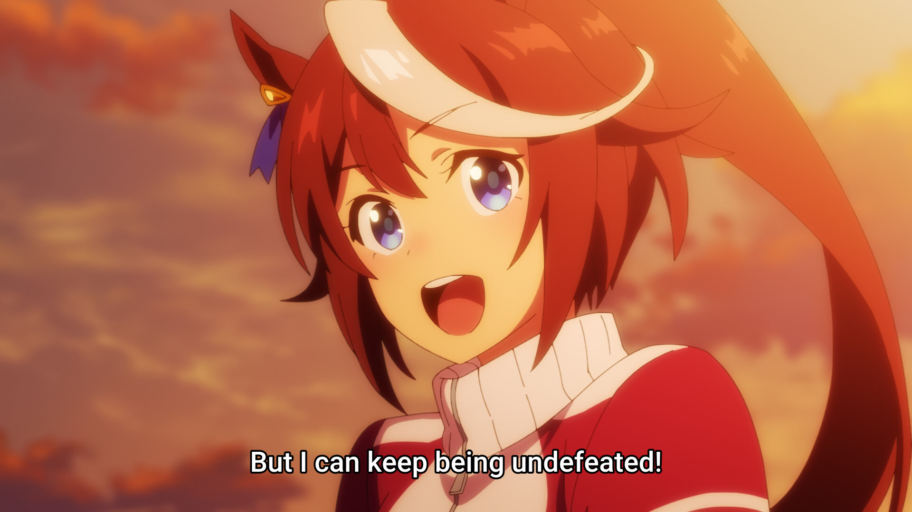 |

Teio's first defeat was pure bad luck. The injury took the first of her two goals which was the Triple Crown. But she took it well, since nobody's at fault and she still had "undefeated" to hold on to. The second defeat, however, was her true breaking point. While I don't think Teio was blind enough not to cherish having McQueen as an opponent, but after she lost to McQueen, I doubt she could think of anything other than "my last goal is gone" and thus her demoralizing arc commenced. Did she regret her choice of picking a race with McQueen? I simply don't know. The only thing I know for real is that Teio did not see the real value in their rivalry. In her logic, losing to McQueen didn't mean "my proving ground is working," it meant she was finished. By this time, both her talent, effort, and luck were all tested; and the unappealing test result meant more to her than what the test was for. Then came her third defeat: to herself. The repeated injuries, plus the sense that she'd never be as good as she once was, kept her off the track until she gave in.

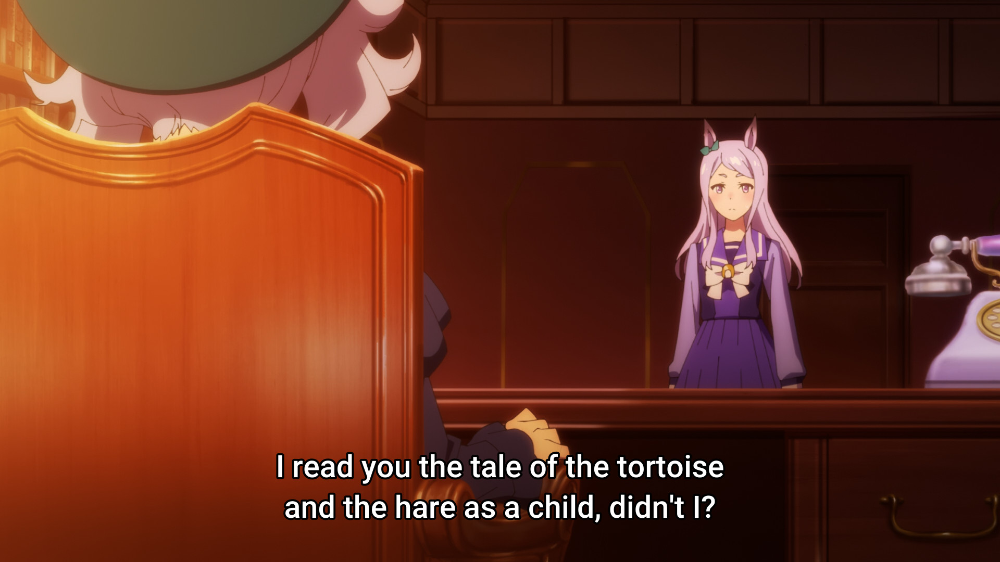

> "Do you understand how the tortoise won?"  
> "The rabbit was looking at the tortoise. But the tortoise was looking at the goal."

Teio and I were both the rabbit. We could not see the true "goal" which is the **bigger picture** both McQueen and Kither already had on sight. They honed their talent for the love of the craft and along the way they inspire and influence others for the better; while we, instead of letting the goodwill rivalry propel us toward their vision, saw nothing further than winning the rival in front of us, winning some competitions we'd set for ourselves, being satisfied by feeding on our ego. I can't blame Teio though; I was in the same shoes, albeit my starting point was opposite. Do you know the story behind _"I parted ways with Kither somewhere around the 22nd or 24th of December, 2021"_ in [the first dont-read-me](./dont-read-me.md)? The "parted ways" incident was me earning a seat on HCM national olympiad team while Kither did not. It was a substitute seat, imma be honest; but losing track of Kither as my proving ground really ended all motivations in me. I ditched the classes and went back to my normal highschool life, which was a leisurely experience, and I got my chance to prove myself in a lot of non-competitive-programming-related stuffs; but that also meant I threw away my best (and unfortunately last) chance of becoming a better competitive programmer. Teio broke because she lost to her rival; I broke because I lost sight of mine.

Teio's third defeat was to herself, and so was mine. What followed after my highschool years was an endless spiral of desperation, which was weird and very hard to notice, especially to the over-accomplished like me. At the beginning, missteps just felt like adventures, calculated risks, cheap lessons,... anything but admitting defeat. I knew things weren't going my way but insisted it's still fine---I still had so many cards up my sleeve, I couldn't really be out of tricks, I was still loved by people, still earned recognition, and all the other excuses I could cling onto. I was still scared of backsliding into the loser I once was in my first highschool months, but as failures after repeated failures slowly stripped away my confidence bit my bit, a rude awakening came to me, and eventually cultivated into [the first dont-read-me](./dont-read-me.md). That writing ended without a closure, did it? It ended with a question: _"What becomes of me then?"_. I think now is a good time to write down the answer: where have I been, and who I am now.

_Analysis time's over. Aggressive venting time!_

The prophecy in that writing _"somewhere late 2026 or 2027, my time will run out and my curtain will fall"_ turned out to be half-correct for about six months after its publication. The wrong half I wouldn't find out by surprise about until much later; the correct half, I lived through **word for word**. First thing it got right was that 2025 was not my rock bottom. In TTHCMUS 2025 despite the massive, generational choke I brought to the semifinals, my clutches in the qualifiers earned us our spot there in the first place and I'm quite proud of that. Logically, a fourth-year is supposed to outgrow his third-year self, especially one fueled by that much self-loathing. Instead I got ridiculously worse. We still had a blast at the TTHCMUS 2026 semifinals, but only because my teammates had surpassed everything I could have been and carried my deadweight. Once again I had nothing but a facade, a reputation, and zero power to do anything remotely helpful for the people I love. From the deepest of my heart, I didn't envy them; I just hated how fast I'd been falling off.

The fall wasn't a misfortune. There's a Vietnamese saying that roughly translates to "If you do not take what Heaven gives, you will suffer its punishment in return." From what I understand, Heaven isn't malicious about it; it simply hands you a head start and watches what you do with it, and the punishment is paid in everything the gift could have become. Heaven was generous with me. I entered uni with advantages most students could only wish for: a programming foundation years ahead of my class; a reputation that opened doors before I knocked; people like Kither, who were not only better than me but also willing to pull me along; and a job in my freshman year, the thing most people spend their whole degree chasing. Of "talent, effort, and luck," I walked in with an abundance of all three. Yet in my utter stupidity, ignorance and cowardice, I let them all slip away. By my last year, the talents I'd banked on had nothing left to compound, nonetheless I had nothing but them to carry all three things at once: my thesis, my work, and and whatever long-term move was supposed to come next. I ended up being torn in three directions thereof, and slowly suffocating, panting like a dog, clutching my chest like I couldn't breathe, banging my head in the middle of the night. I again found myself embarrassed, disgusted with myself and the state of my life. I couldn't control my situation or what was to come anymore, it felt like I'd be stuck like this forever.

I've never told anyone this, but I haven't been able to sleep without dreaming since I was 13. Long night or short 5-minute nap, including every single classroom doze-off, there's always a vivid, hyper-realistic dream, mostly non-lucid. I don't know how common this is, but I don't hate it even though I do envy people who can just sleep straight and wake up fresh. Occasionally, the dreams showed me new perspectives I'd never have thought of while awake; some other times they flat out handed me ideas. The day I learned the $O(log(n))$ algorithm for GCD, the LCM formula derived from it came to me in my sleep (pretty useless, but it's a fun anecdote). Many of the competitive programming problems I set for my underclassmen came from dreams too, and pretty creative ones at that. I don't remember thinking negatively about my dreams ever,... until those days, when the suffocation of hopelessness and the hatred I held for myself followed me into my sleep. I had night-to-night back-to-back nightmares for straight weeks. My rightful peace in slumbers was ripped off, while I was already clawing through partially self-induced insomnia and unprecedented exhaustion and overwork?? Beyond mere restlessness, it has been the most humiliated, vulnerable interval of my life so far. Then one night I dreamt of Kither and bonz -- and in another part of the same dream, ewallis -- walking ahead of me. I tried to reach them, but I just couldn't; I'd fallen so far behind that I didn't even want to bother them anymore. That was maybe the scariest dream of my life. But yet, after that, the nightmares didn't come anymore. It was as if the dream told me to stop fighting. It brought me very close to acceptance.

That was the state I was in when I watched Uma SS2. On a leisurely Saturday, I sat down for the binge; and a few hours in, Teio had that exact dream of mine. McQueen pulls away from her first, then the rest of team Spica, one by one, until she's alone on the track. Losing sights of the tortoise was apparently not the rock-bottom for the hare; she watched everyone she'd ever run with sprint out of her reach. And then the scene comes:

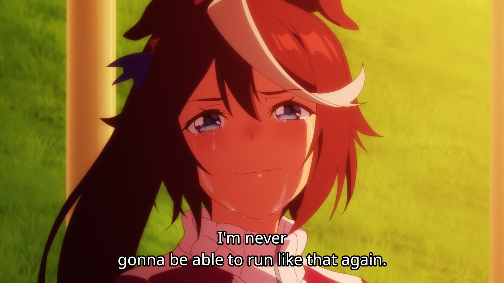

It was then that I understood what the dream had been telling me, and the acceptance came in full. I could not race alongside them anymore. _"A hermit, finally quiet, finally still. Finally done disappointing the world."_ I proceeded to watch the remaining four episodes anyway, but I wasn't relating to Teio anymore. As I hope many of us know, any hero's journey with a low point like this ends in repentance, and in Teio's canon that repentance even came with a result that immortalized her in the hall of fame of horse racing. Who was I to dare relate to that? We were never the same kind of person, and I'd been insulting her by pretending we were. So I sat back and let her journey be hers, and got lost in the thrill of it. I could do nothing but watch.

...

Or so I thought.

Episode 10 picks up right where Teio's acceptance left off. The first thing she did was nonchalantly remove her "Win against McQueen at the Takarazuka Kinen" poster on the wall, then filed a letter of resignation. Then came her first day of retirement. She wandered around trying every fun activities, some of which had been her favorites as shown thorough the series, and we do see her laughing through all of it. But both we and she could tell she looked sad as shit. "Has one day always been this long" yeah you're right Teio, it's long because you're sad, you're regretful, because you feel guilty and lonely and you're bored to death, and you can't swipe them off with these distractions you call "fun activities". It took until the end of the episode for Teio to recollect her mind; plus Twin Turbo's stunt in tandem with the overwhelming love the audience still had for her, Teio realized she didn't need being the best as a reason to race -- she could just race. Purely for the love of the game. No need to be undefeated. And that's how she gained the confidence to race without reservation, and this struck a chord with me.

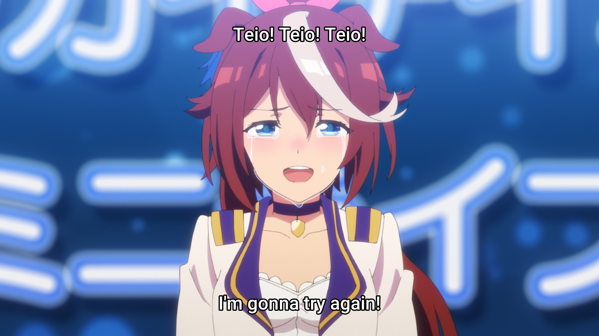

Funnily enough, Teio wasn't the only one filing resignations that season. A few weeks before the binge, back when I was still embarrassingly torn between school and work, the humiliation got so bad that I straight up asked SiGlaz to let me resign. Looking back, it was a plain over-reaction, thankfully the people there cared enough to calm me down from it. And that event right there, that exact manner in which I lost my face but not my race track---for someone who'd always been living behind a charade---was the prerequisite for my forthcoming comeback.

Not to preach to the choir, but just in case there was anyone who still hasn't realized it yet, there's a reason why peace of mind is absent from every single one of these writings: I can never be at peace. Just like Teio whose retirement only lasted a few days, my _"hermit"_ phase only lasted three. And just like Teio who could only give her all after letting go of being undefeated, I went at fuck-all knots after letting go of my charade. I reclaimed the boldness to do shit without shame or reservation; I experimented at a 99.95% failure rate, doubled down on everything I'd already been doing, and didn't care how miserable or desperate I'd look if none of it ever worked out. Who was going to judge me, the guy who'd already written himself off?

The two months that followed were absolutely phenomenal, but if I yapped about them here, it would read like a boring report. So until I get better at narrating a journey of overcoming hardship, please get used to me only telling you the fruits of said journey. Marxist philosophy has a mouthful of a name for what happened: "the law of the transformation of changes in quantity into changes in quality", which is to say that gradual, cumulative quantitative increases will eventually trigger a sudden, fundamental change in nature. All my failed attempts in [the first dont-read-me](./dont-read-me.md), futile and embarrassing as they looked when they happened, turned out to be blades I'd been forging all along without knowing; and those two months, which I just refused to tell you about, were me continuing to sharpen them but with unprecedented recklessness and discipline. _Fortuna Eruditis Favet_ -- luck smiles on the prepared. Talent, effort and luck had become such essential parts of who I was; but of those three, only two can be trained. Luck shows up whenever it damn well pleases, and all I could do was make sure I wouldn't be caught empty-handed when it does. So I kept grinding, preparing, sharpening, and when the chance to redeem myself finally came, I already had everything I needed not to let it slip this time.

The chance came as an email from BioTuring. As the deadweight my teammates had hauled into the top 6 of TTHCMUS, I got a fast track to the entrance test there; and forthrightly, out of all the companies I'd scouted, BioTuring was the most promising. I'd looked into, and even sparred in interviews with, a good handful of others (most prominently Axon, VNG, FPT, Zalos the fintech startup, and Grab), but BioTuring was the only one that checked every box: it isn't a JSC, it has a genuine frontier mission that research and engineering nerds can dedicate their lives to without worrying about shareholder shenanigans, it's still rich as hell, and its clients are honestly awesome people. To get a seat there I had to clear four rounds. The fast track skipped two, and the CEO interview at the end was the easy part, given four years at SiGlaz. The problem was the third: a competitive programming test, prepared by ICPC regionalists.

Of all the races in the world, the one standing between me and whatever came next was the one I'd walked away from. Hence, those nights in early May, I took every bit of the hatred I'd harboured toward myself over these 4 years and burned it as fuel, all the way up to the very night before the test. The last problem I practiced that night? A Trie. Why a Trie? Because it's Kither's favorite data structure. That's it. That's the whole reason. And the next day, in the actual test, I wrote the most unconventional solution of my life, and it got AC, and it was built on a Trie. What a fucking serendipity. Kither, once again, showed up like a Deus Ex Machina without even being there. Out of 960+ applications full of ICPC maniacs, some more accomplished than even the over-accomplished image I had of myself, BioTuring's special program accepted 4, and I was one of them. The other three are everything I could have wished to be but never was. That's fine by me tho. I've found my proving ground again, and if there's one thing I've known how to do since childhood, it's running beside geniuses.

---

Postscript.

| 2024 | 2026 |
| ---- | ---- |
| 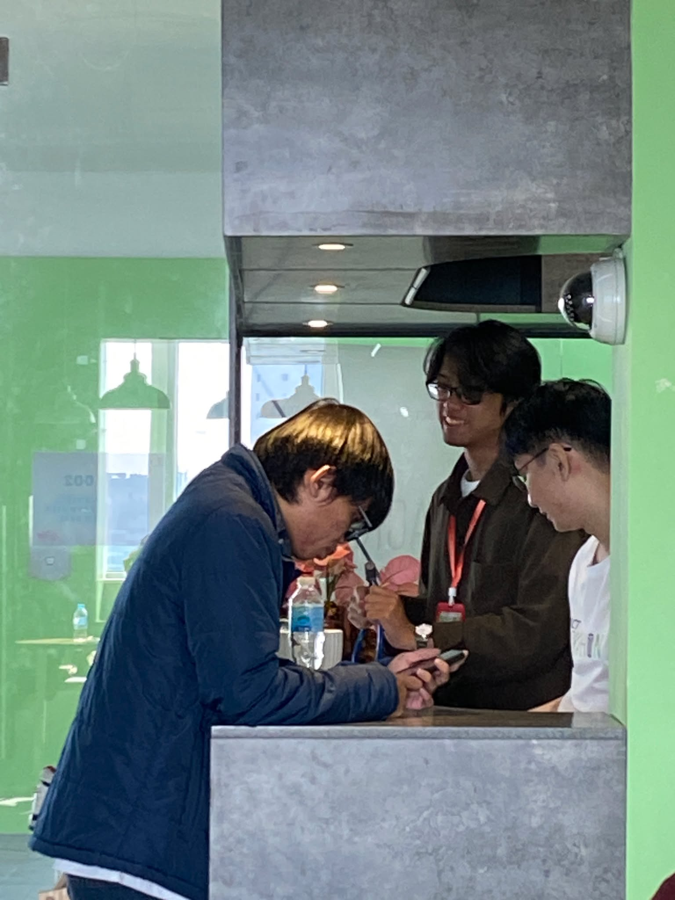 | 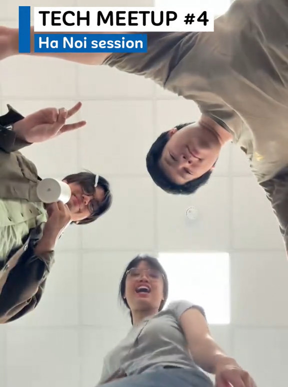 |
| 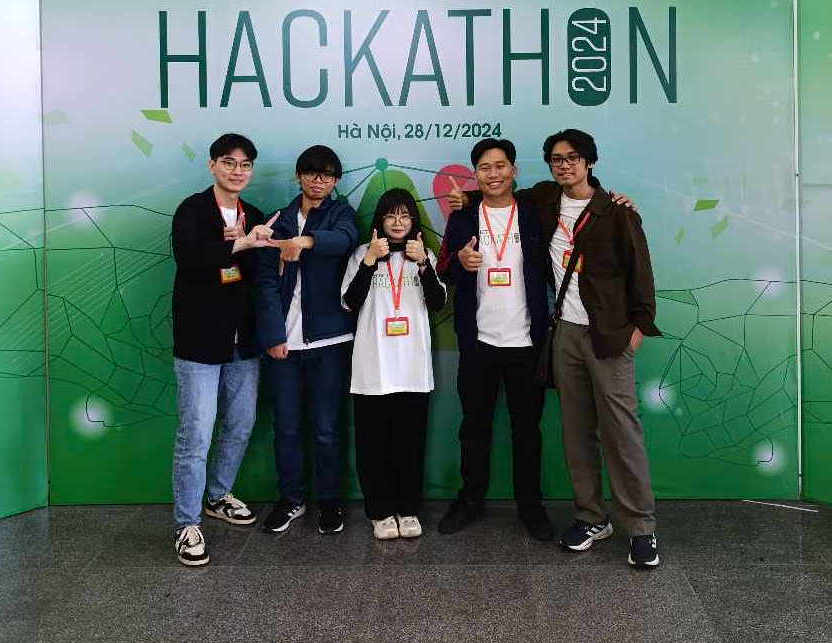 | 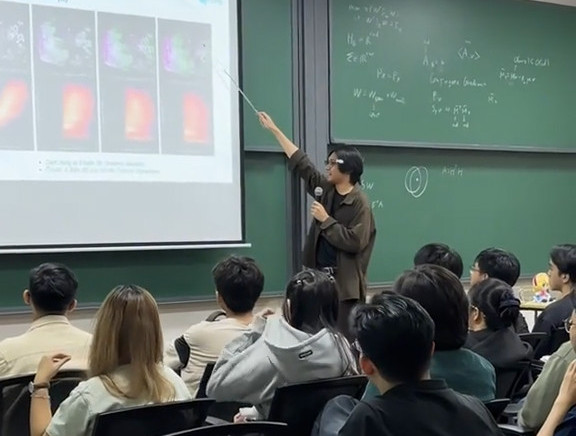 |
| 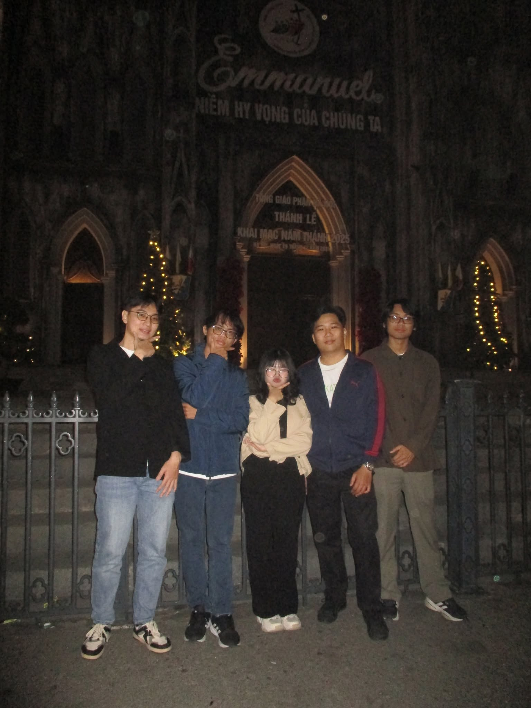 | 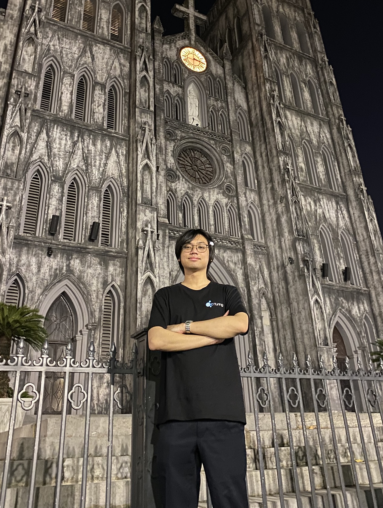 |
| 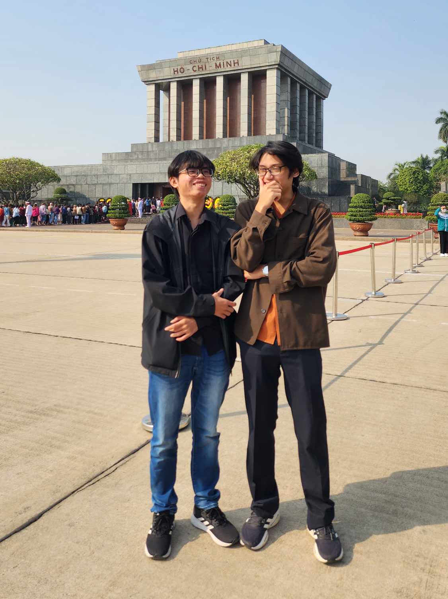 | 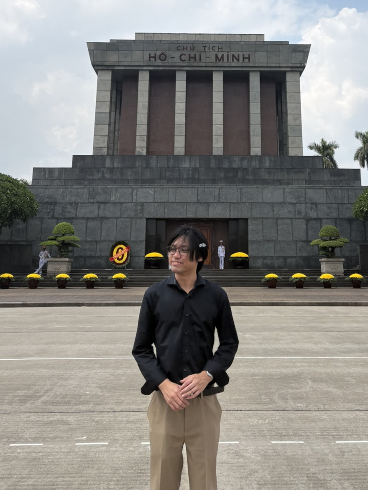 |

It's been nearly 5 months since I joined BioTuring. In similar fashion to how Teio's story doesn't end at her episode 10 comeback, my story has only started to lift-off now. You see, I reminisence about that rose-colored period of my highschool life a lot. I cherished the sense of belonging, of being curious, being recognized, being receprocated, of seeing my sufferings and endless wandering pay off. For the first time since then, I'm making memories that can emotionally stand on par with it, and at an increasingly rapid pace. I wake up everyday in a magnetic sense of exploration and wonder about what I'm contributing to; I'm excited by the endless possibilities in my hands; I have enough enthusiasm and purposes to propel me for years. And once again, I've fallen in love with these people---new friends and old ones alike---and grown, once again, addicted to the warmth they make me feel. And as a cherry on the top: I now earned 5 to 6 times the [average Vietnamese income](https://thuvienphapluat.vn/chinh-sach-phap-luat-moi/vn/ho-tro-phap-luat/chinh-sach-moi/102644/thong-ke-thu-nhap-binh-quan-cua-nguoi-lao-dong-nam-2025), I'm not paid on the clock, I get to set my own KPIs, and my coffee, lunches and dinners are free; I'm literally free of any financial burden and can just focus on my craft like a mad man. I don't see any of what I'm building now crashing and burning anytime soon. If anything, I owe my pathetic ass a sincere thank you for those 4 years of falling from grace. As corny and stupid as it sounds, they really taught me the how and the mental capability never to repeat that mistake. At the end of the show, Teio's feat was greatly more magnificent than what it would have been should she just win Triple Crown, wasn't it? For the same reason, I cherish my aimless despairs and accomplishments all the same, and won't be afraid to risk either of them again.

This would conclude most of my problems, huh? Yeah, "most". I've missed out a lot on my journey here, and there are more to come. But that's for another dont-read-me. So wait til then, heh?

See you later.

